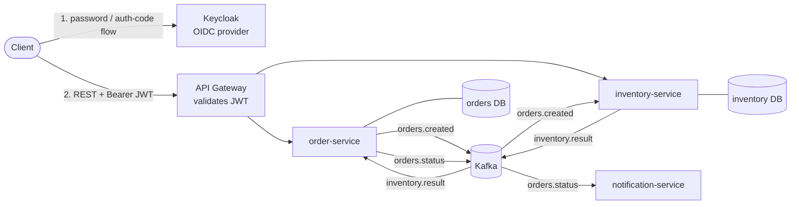

# Event-Driven Order Processing

Spring Boot microservices that process orders through Apache Kafka, secured with
OAuth2/OIDC (Keycloak) and JWT, and run as Docker containers behind an API gateway.

**Stack:** Java 21 · Spring Boot 3.3 · Spring Cloud Gateway · Spring Security (OAuth2 resource server) ·
Spring Kafka · Spring Data JPA · PostgreSQL · Keycloak · Docker Compose · JUnit 5 / Mockito / Embedded Kafka

## Architecture



An order is a small **choreographed saga**:

1. `POST /api/orders` stores the order as `PENDING` and returns **202 Accepted**.
2. After the database commit, order-service publishes `OrderCreatedEvent` to `orders.created`.
3. inventory-service reserves every line or none of them, then publishes `InventoryResultEvent` to `inventory.result`.
4. order-service marks the order `CONFIRMED` or `REJECTED` and publishes `OrderStatusEvent` to `orders.status`.
5. notification-service tells the customer.

| Service | Port | Responsibility |
|---|---|---|
| api-gateway | 8080 | Single entry point. Rejects requests without a valid JWT, routes to services |
| order-service | 8081 | Order REST API, order state machine, saga coordinator |
| inventory-service | 8082 | Stock levels, all-or-nothing reservations, admin restock API |
| notification-service | 8083 | Consumes status events and notifies customers (logged in this demo) |
| Keycloak | 8180 | OIDC provider. Realm `orders`, users and roles imported at startup |
| Kafka | 29092 | Single-node KRaft broker (no ZooKeeper) |

## Design decisions

- **Security at two layers.** The gateway authenticates every call. Each service then validates the
  same JWT again as an OAuth2 resource server and applies its own role rules (`customer`, `admin`), so
  a service is never exposed just because traffic got past the edge.
- **Keycloak roles → Spring authorities.** `KeycloakRealmRoleConverter` maps the `realm_access.roles`
  claim to `ROLE_*` authorities, which makes `hasRole("ADMIN")` work.
- **Publish after commit.** Events go to Kafka from a `@TransactionalEventListener`, so consumers never
  see an order that was rolled back.
- **Idempotent consumers.** Kafka delivers at least once. inventory-service records each processed
  order and replays the stored result on redelivery, and order-service ignores results for orders
  that are no longer `PENDING`. A duplicate message can never reserve stock twice.
- **Ordering per order.** Every event is keyed by order ID, so all events for one order land on the
  same partition and are consumed in order.
- **Dead-letter topics.** A record that keeps failing is retried 3 times and then moved to
  `<topic>.DLT` instead of blocking its partition.
- **Optimistic locking.** `@Version` on `Product` stops two concurrent reservations from overselling.
- **Database per service.** Each service owns its own PostgreSQL database and shares only event contracts (`common`).

## Run it

Requires Docker.

```bash
docker compose up -d --build --wait
bash scripts/e2e.sh
```

`e2e.sh` gets real tokens from Keycloak and checks the full flow through the gateway: confirmed
and rejected orders, 401 for missing or forged tokens, 403 for the wrong user or role.

Try it by hand:

```bash
TOKEN=$(curl -s -X POST http://localhost:8180/realms/orders/protocol/openid-connect/token \
  -d grant_type=password -d client_id=order-client -d username=alice -d password=alice \
  | sed -n 's/.*"access_token":"\([^"]*\)".*/\1/p')

curl -s -X POST http://localhost:8080/api/orders -H "Authorization: Bearer $TOKEN" \
  -H 'Content-Type: application/json' -d '{"lines":[{"sku":"KEYBOARD-01","quantity":1}]}'

curl -s http://localhost:8080/api/orders -H "Authorization: Bearer $TOKEN"
docker compose logs notification-service
```

Demo users: `alice`/`alice` and `bob`/`bob` (customers), `admin`/`admin` (admin + customer).
Seeded SKUs: `KEYBOARD-01` (50), `MOUSE-01` (100), `MONITOR-27` (3).

> The password grant is used only so the demo works from `curl`. A real front end would use the
> Authorization Code flow with PKCE, which the `order-client` client also supports.

## API

| Method | Path | Role | Description |
|---|---|---|---|
| POST | `/api/orders` | customer | Place an order. Returns 202 with status `PENDING` |
| GET | `/api/orders` | any user | The caller's own orders |
| GET | `/api/orders/{id}` | owner or admin | One order |
| GET | `/api/inventory` | any user | All products and stock |
| GET | `/api/inventory/{sku}` | any user | One product |
| POST | `/api/inventory/{sku}/restock` | admin | Add stock (creates the SKU if new) |

## Tests

```bash
bash mvnw verify        # on Windows: mvnw.cmd verify
```

- Unit tests for the order state machine, the role converter and notification messages.
- `@WebMvcTest` security tests: 401 without a token, 403 without the right role, ownership checks, validation.
- `@DataJpaTest` for reservations: all-or-nothing, unknown SKUs, duplicate lines, idempotent redelivery.
- Integration tests against an **embedded Kafka broker** for both sides of the saga.
- Gateway tests showing unauthenticated and forged-token requests are rejected at the edge.

CI (GitHub Actions) runs the test suite, then starts the whole stack with Docker Compose and runs `e2e.sh`.

## What I would add next

- **Transactional outbox** (or Debezium CDC) so the database write and the Kafka publish cannot drift apart if the broker is down at commit time.
- Distributed tracing with Micrometer Tracing + OpenTelemetry, and correlation IDs in logs.
- Rate limiting at the gateway with Redis.
- Flyway migrations in place of `ddl-auto`, and Testcontainers for Postgres/Kafka in integration tests.
